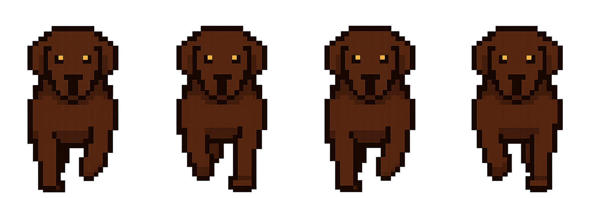
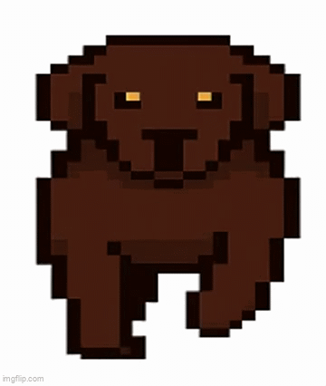

# 🎨 AI-bild och SVG-animation

## 👤 Uppgift
I denna väldigt roliga uppgift har vi fått fokusera på:
- att skaffa förståelse för olika filformat (t.ex. PNG, SVG)
- jobba problemlösnings-orienterat inom frontend-relaterade områden
- att arbeta kreativt med grafik och animation

---

## 🖼️ 1. AI-genererad bild

### 🧠 Idé
Jag testade mig fram och genererade ganska många bilder men blev aldrig riktigt nöjd. Till sist valde jag att generera en Sprite-sheet föreställande en pixel-hund som går mot en. Nästan som en "spel-gubbe". Inspirationen tog jag från min bruna labrador. Slutligen tänkte jag använda denna på min portföljsida. 

### 🛠️ Verktyg
Bild genererad med:
- *CoPilot och Gemini*

Justerad i: 
- *Figma*

### 🖼️ Resultat

---

## ✏️ 2. SVG + animation

### 🧠 Idé
Även här ville jag ta fram något att använda på min portfölj-sida. Därför tog jag fram en SVG med text ("Lottie Jonsson") där:
- jag har outlinat texten (för att inte vara beroende av font)
- minimalisten i mig bestämde att den enda delen i VG:n som är animerad är punkten över i. 

Jag kombinerade detta med en pixel-art sprite-animation av en hund för att skapa ett mer levande uttryck. I efterhand kanske jag hade velat skriva namnet på hunden snarare än mitt eget, men det får bli ett senare projekt när jag skapar en egen webbsida för hunden.

---

### 🔧 Teknik

Jag använde:
- **SVG (vector graphic)**
- **GSAP (animation library)**

Animationerna inkluderar:
- en pulserande punkt i SVG:n
- en sprite-animation (frame-by-frame) av en hund
- loopande animationer

---

### 🎬 Demo

👉 **Live-version (GitHub Pages):**  
Länk:  
https://github.com/Medieinstitutet/fed25d-grafiska-verktyg-individuell-lotjons

---

### 🎥 Inspelad animation

## Utmaningar & problemlösning

Under arbetet stötte jag på ett gäng problem:

### Problem: sprite-animation blinkade
- **Orsak:** fel antal `steps()` i animationen
- **Lösning:** matchade antal frames korrekt (`steps(3)` för 4 frames)

---

### Problem: element "wobblade"
- **Orsak:** framesen var inte centrerade
- **Lösning:** justerade sprite-sheet så varje frame hade samma mittpunkt

---

## Filformat

### PNG
Används för sprite-sheet (pixelgrafik)

### SVG
Används för vektorgrafik (skalbar och lätt att animera)

---

## 🚀 Lärdomar

Genom denna uppgift har jag:

- Absolut fått bättre förståelse för skillnaden mellan olika bildformat  
- Lärt mig animera SVG med GSAP! Det var nice!
- Lärt mig om och jobbat med sprite sheets och frame animation  
- Tränat extra på felsökning i browser (DevTools, 404 errors)  

---

## ✅ Slutsats

Uppgiften påminde mig om vikten av att:

- Kunna hantera flera olika tekniker samtidigt  
- Förstå hur frontend, grafik och struktur hänger ihop  
- Kunna lösa problem utanför “ren kodning”  
